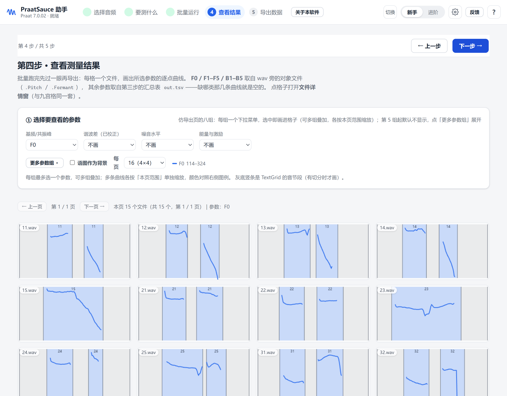

# PraatSauce 助手

> 给 [PraatSauce](https://github.com/kirbyj/praatsauce) 套一个中文、零编程门槛的图形界面。
> **所有声学参数都由你本机的 [Praat](https://praat.org) 计算**，本程序只负责选文件、配参数、
> 批量调度、展示与审核结果。

源码仓库：<https://github.com/lingfengsh/praatsauce-shell>
（`praat.exe` 不随仓库分发，配置方法见下文「准备 Praat」。）

<!-- 拿到 Zenodo DOI 后，把下面这段取消注释并替换 XXXX：
[](https://doi.org/10.5281/zenodo.XXXXXXX)
-->

<p align="center">
  
</p>

一套围绕 Praat 的语音声学分析工作台：批量提取 F0、共振峰、H1-H2、HNR、CPP、SHR、SoE 等
50 余项指标，带试跑体检、九宫格审核、人工修正与结构化导出。面向语言学 / 语音学 /
方言与发声态研究，Windows 平台，离线可用。

当前版本：**1.2**（向导界面）

---

## 目录

- [它解决什么问题](#它解决什么问题)
- [快速开始](#快速开始)
- [Praat 从哪里来](#praat-从哪里来)
- [工作流](#工作流)
- [目录结构](#目录结构)
- [从源码运行](#从源码运行)
- [构建发布包](#构建发布包)
- [测试](#测试)
- [已知限制](#已知限制)
- [许可证](#许可证)
- [引用](#引用)

---

## 它解决什么问题

[VoiceSauce](https://www.phonetics.ucla.edu/voicesauce/) 是这一领域的经典工具，但它有两个门槛：
要装 MATLAB Runtime（几个 GB），而且只能整目录盲跑 —— 参数设错，全部重来。

[PraatSauce](https://github.com/kirbyj/praatsauce) 用 Praat 脚本实现了大部分同类指标，轻量、
开源、可改；但它是命令行脚本集，55 个参数的 `params.csv` 对非技术用户并不友好。

本项目在两者之间补上操作层：

| 痛点 | 这里的做法 |
|---|---|
| 55 个参数看不懂 | 三档视图（新手 / 进阶 / 专家），新手只面对 5 个决定 |
| 参数错了要全部重跑 | 先试跑 1 个文件，看 F0 / 共振峰曲线和体检结论，确认后再批量 |
| 不知道哪个文件测坏了 | 按文件统计基频检出率，自动点名异常文件（排除静音段干扰） |
| 逐段核对很费眼 | 九宫格批量看图 + 单文件详情，支持删帧 / 加点 / 改 F0 / 平滑共振峰 |
| 结果要自己拼表 | 一键导出 CSV / XLSX / 逐文件 / 逐参数四种版式 |

---

## 快速开始

### 用发布包（推荐给大多数用户）

1. 解压 `PraatSauceShell-1.2.zip` 到任意目录（**路径避免中文和空格**，例如 `D:\PraatSauce`）。
2. 双击 `PraatSauceShell.exe`。
3. 第一次打开会自动进入向导：选音频目录 → 选要测什么 → 试跑 → 批量。

发布包已经自带 `praat.exe`，开箱即用。

### 用源码

见 [从源码运行](#从源码运行)。

---

## Praat 从哪里来

本程序的**源代码仓库不包含 `praat.exe`**（它是 90 多 MB 的二进制，且许可是 GPL，
与本项目的 MIT 不同 —— 见 [许可证](#许可证)）。程序按以下顺序找 Praat：

| 顺序 | 位置 | 说明 |
|---|---|---|
| 1 | 设置页手动指定 | **最推荐**。点「设置 → Praat 程序路径 → 浏览」，选中 `Praat.exe` |
| 2 | 与主程序同目录 | 把 `praat.exe` 复制到 `PraatSauceShell.exe` 旁边即可，便于绿色部署 |
| 3 | 常见安装位置 | `C:\Program Files\Praat\Praat.exe`、`%LOCALAPPDATA%\Programs\Praat\Praat.exe` 等 |
| 4 | 都没有 | 设置页会给出下载提示 |

Praat 官方下载：<https://praat.org>

> **版本要求**：建议 Praat **6.4.01 及以上**。上游脚本以 6.4.01 为测试基线，大量使用
> 向量化运算与较新的 `To Pitch (filtered autocorrelation)`，版本太老会直接报错。
> 本项目实际验证版本为 **7.0.02**（2026-08-26 构建）。

---

## 工作流

五步向导，每一步都能回头改：

| 步骤 | 做什么 | 为什么放在这一步 |
|---|---|---|
| **1 选择音频** | 选目录，看文件数 / 时长 / 采样率 | 先确认读到的东西是对的 |
| **2 要测什么** | 选研究目标预设 + 发音人，参数自动配好 | 新手不用面对 55 个参数 |
| **3 批量运行** | 运行前检查 → 进度 / 日志 → 结果诊断 | 参数错了在这里拦住，不把锅甩给 Praat 的报错 |
| **4 查看结果** | 九宫格一屏 9 个文件，点进去看单文件详情 | 批量跑完不等于测对了，要能逐段核对 |
| **5 导出数据** | 选列、选版式、导出 CSV / XLSX | 结果要能直接进 R / Python |

**试跑**嵌在第三步：点「开始批量处理」之前可以先只跑 1 个文件，看完基频 / 共振峰曲线
和体检结论，确认没问题再放开整批。这是 VoiceSauce 最缺的一环。

<p align="center">
  
</p>

第四步的九宫格可以**改**，不只是看：一屏 9 个文件，看基频点是否落在元音段上、共振峰轨迹
是否连续；点进单个文件可以删掉误判的帧、手工补点、切分 TextGrid、平滑共振峰轨迹。
审核过的结果会写回 `measure/` 目录，下次批量直接复用，不重算。

<p align="center">
  
</p>

### 主要能力

- **基频**：Praat `To Pitch (filtered autocorrelation)`，先试跑定范围再批量
- **共振峰**：Burg / 多档 LPC 阶数择优，FormantPath 精修，Viterbi 平滑
- **声质**：H1-H2、H1-A3、HNR（分频带）、CPP / CPPS、SHR、SoE、能量
- **区间**：按 TextGrid 标注段测量，自动配对同名 TextGrid，静音段不计入检出率
- **导出**：TSV / CSV（带 BOM）/ XLSX；单表、逐文件、逐参数四种版式
- **可复现**：参数落盘为 `params.csv`，中间对象存 `measure/`，随时可重跑比对

---

## 目录结构

```
praatsauce-shell/
├── ps-shell/              主程序
│   ├── app.py             入口：本地 HTTP 服务 + 原生窗口
│   ├── backend/           后端（参数、Praat 调用、批量调度、审核、导出）
│   ├── ui/                前端（原生 JS，无框架、无 CDN，完全离线）
│   ├── tests/             unittest + 前端回归脚本
│   ├── tools/             合成示例音频生成器
│   └── vowel_data/        IPA 元音参考值（候选排序与 Track 先验）
├── scripts/               实际运行的 Praat 脚本（含上游 PraatSauce + ps_ 扩展）
├── praatsauce-master/     上游 PraatSauce 1.0.8 原样副本（MIT，供对照）
├── packaging/             打包脚本
│   ├── PraatSauce.spec    PyInstaller 配置
│   ├── stage.py           组装分发包（复制 ui/scripts/samples/praat.exe）
│   ├── fetch_wheels.py    下载 pywebview 等依赖到 _build/_vendor
│   └── 入手简介.txt       随包短说明
├── docs/
│   ├── screenshots/       README 截图
│   └── PraatSauce使用说明.docx
├── build_usage_doc.py     生成上面那份 docx
├── LICENSES/              GPL-3.0 与上游 MIT 全文
├── LICENSE                本项目 MIT
├── THIRD-PARTY-NOTICES.md 第三方组件与 Praat 许可说明
├── CITATION.cff           引用信息
└── CHANGELOG.md           版本记录
```

`samples/`、`_build/`、`logs/`、`praat.exe` 都不入库（见 `.gitignore`）。
`samples/` 可用 `python ps-shell/tools/make_samples.py` 重新生成。

---

## 从源码运行

需要 **Python 3.13**（3.10+ 应该也可以，未逐一验证）。

```bash
git clone <本仓库地址> praatsauce-shell
cd praatsauce-shell

# 可选：装原生窗口依赖。不装也能跑，只是界面开在浏览器里
pip install pywebview

# 启动
python ps-shell/app.py
```

`app.py` 起一个只监听 `127.0.0.1` 的本地服务，随机端口，仅本机可访问。关闭窗口后
服务会自行退出；调试时也可以用 `python ps-shell/serve_only.py` 只起服务、不开窗口。

然后按 [Praat 从哪里来](#praat-从哪里来) 配好 Praat 路径，就可以跑示例数据了。

---

## 构建发布包

只在 **Windows** 上构建（产物是 Windows exe）。需要 Python 3.13 + PyInstaller。

```bash
# 0) 准备依赖（只需第一次；会下载 pywebview/pythonnet 等 wheel 到 _build/_vendor）
python packaging/fetch_wheels.py

# 1) 编译（产物在 _build/dist/PraatSauceShell）
python -m PyInstaller --noconfirm \
    --workpath _build/build --distpath _build/dist \
    packaging/PraatSauce.spec

# 2) 组装外部资源（ui/ scripts/ samples/ praat.exe 等复制到 exe 同目录）
python packaging/stage.py

# 3) 试运行
_build\dist\PraatSauceShell\PraatSauceShell.exe
```

**两个容易踩的坑**：

- `--workpath` / `--distpath` 必须显式写成上面这两个路径。不写的话 PyInstaller 会输出到
  当前工作目录下的 `build/` 和 `dist/`，与 `stage.py` 的组装目录错开 —— 表现是"改了却没生效"。
- `ui/`、`scripts/`、`samples/` 是**外部资源**，不进 exe。改界面、改脚本不需要重新编译，
  只有后端 `.py` 变了才要重打。`stage.py` 结尾会做新鲜度检查。

打 zip 前记得把 `praat.exe`、`samples/`、`docs/` 一并放进分发包，并附上
`LICENSE`、`LICENSES/`、`THIRD-PARTY-NOTICES.md`（GPL 合规要求，见下）。

---

## 测试

```bash
# 后端（mock 掉 Praat，不需要真跑）
python -m unittest discover -s ps-shell/tests -t ps-shell -v

# 前端回归（node vm，不需要浏览器）
node ps-shell/tests/rg_ui_regress.js
```

前端回归覆盖九宫格渲染、选择保存、导出参数、F0 手工点算法等纯逻辑分支，
GUI 相关的部分靠手工验收。

---

## 已知限制

- **仅 Windows**。代码本身是跨平台的（Python + 原生 JS），但打包脚本、pywebview 的
  WebView2 后端、以及部分 Praat 控制台解码逻辑是按 Windows 写的。
- **Praat 路径必须正确**。找不到 Praat 时不会静默失败，会明确报错并给出下载地址。
- **中文路径**：读取没问题，但个别 Praat 版本写文件时对非 ASCII 路径支持不好，
  建议音频和输出目录都用纯英文、无空格路径。
- **超长录音**：整段测量很慢且占内存。10 分钟以上的录音建议先做 TextGrid 切分。
- **共振峰上限**：`maxFormant` 默认按发音人给（男 5000 / 女 5500 / 儿童 5500 Hz），
  嗓音特殊的发音人需要手动调；太高会引入虚假极点，太低会丢 F3/F4。
- **不做统计**。本程序只负责"把数测出来并保证测得对"，混合模型、归一化、绘图请导出后
  交给 R / Python / Praat。
- `praatsauce-master/` 是上游原样副本，只作参考；实际运行的是 `scripts/` 里的版本
  （已打补丁，差异见 [THIRD-PARTY-NOTICES.md](THIRD-PARTY-NOTICES.md)）。

---

## 许可证

本项目代码以 **MIT** 发布，见 [LICENSE](LICENSE)。

但发布包里的 `praat.exe` **不是 MIT**：

| 组件 | 许可证 | 说明 |
|---|---|---|
| 本程序（ps-shell、ps_*.praat、构建脚本） | MIT | 随便用，保留版权声明即可 |
| `praat.exe` | **GPL-3.0-or-later** | © Paul Boersma & David Weenink |
| `praatsauce-master/` 与 `scripts/` 中的上游脚本 | MIT | © 2024 praatsauce authors |

本程序通过**子进程**调用 Praat（命令行参数 + 文件交换），不链接、不派生，因此自身
不必变成 GPL。但如果你分发**包含 `praat.exe` 的安装包**，需要同时提供：

1. Praat 的许可证全文（[`LICENSES/GPL-3.0.txt`](LICENSES/GPL-3.0.txt)）；
2. Praat 的版本与版权信息（[`THIRD-PARTY-NOTICES.md`](THIRD-PARTY-NOTICES.md)）；
3. 源码获取地址：<https://www.praat.org/download_sources.html>。

细节和合规选项见 [THIRD-PARTY-NOTICES.md](THIRD-PARTY-NOTICES.md)。

---

## 引用

如果你在论文里用了本工具，请引用本仓库（见 [CITATION.cff](CITATION.cff)），
**并同时引用上游 PraatSauce 与 Praat**：

```bibtex
@software{praatsauce_shell,
  title  = {PraatSauce 助手：面向中文用户的语音声学参数提取工作台},
  author = {零 \& AI},
  year   = {2026},
  version= {1.2},
  note   = {MIT License},
  url    = {https://github.com/lingfengsh/praatsauce-shell}
}

@software{praatsauce,
  title  = {PraatSauce. Praat-based tools for spectral processing},
  author = {Kirby, James and Puggaard-Rode, Rasmus},
  year   = {2025},
  version= {1.0.8},
  url    = {https://github.com/kirbyj/praatsauce}
}

@manual{praat,
  title  = {Praat: doing phonetics by computer},
  author = {Boersma, Paul and Weenink, David},
  year   = {2026},
  note   = {Version 7.0.02},
  url    = {https://praat.org}
}
```

DOI 的获取方式见 [CITATION.cff](CITATION.cff) 顶部注释，或仓库的 Releases 页面。
